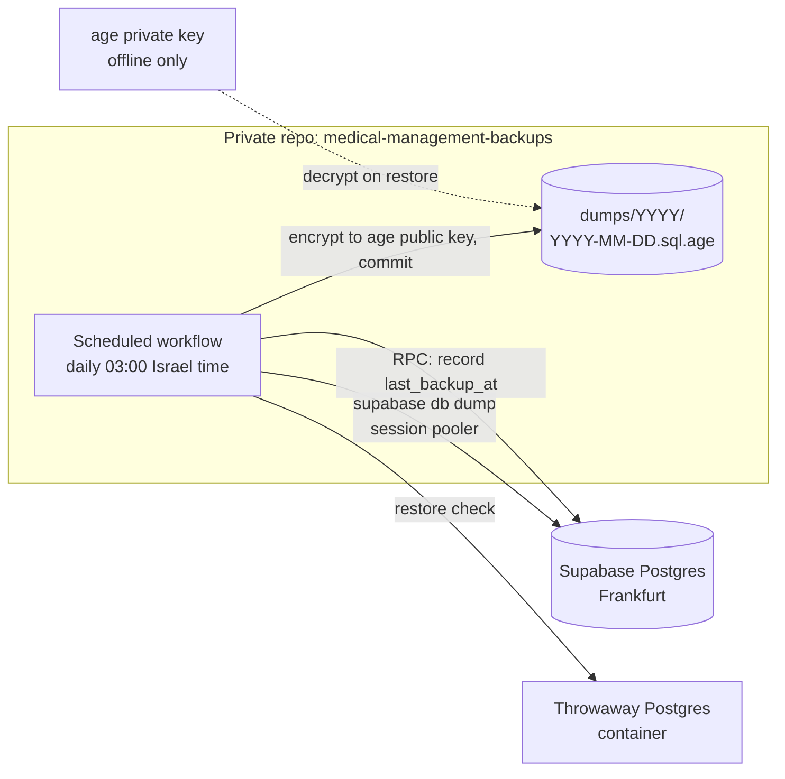

# Backups and data export

How the owner's data is backed up, restored and exported, decided in [Backups and data export](https://github.com/HADKASHI/medical-management-app/issues/13). It builds on the facts in [What does Supabase Free provide for data protection and recovery?](https://github.com/HADKASHI/medical-management-app/issues/12): Supabase Free has no backups you can download, and deleting a project is irreversible. Terms follow [GLOSSARY.md](../../GLOSSARY.md); the stack is in [stack.md](stack.md), and the privacy rules are in [privacy-security.md](privacy-security.md).



## Backup

### Where it runs

- In a **separate private GitHub repo**, `medical-management-backups`. That repo holds both the workflow and the encrypted dumps. Nothing from a backup touches this public repo: no files, artifacts or logs.
- Each run commits that day's dump. The commit counts as repository activity, so GitHub never disables the schedule for inactivity (the 60-day rule in [ADR 0003](../adr/0003-supabase-free-with-external-keepalive.md)).
- Each run takes about a minute, well inside the free Actions minutes for private repos.

### Schedule

**Daily at 03:00 Israel time.** The cron is written in UTC, so it drifts by one hour across DST, which is harmless. At most one day of changes can be lost.

### Contents

The workflow uses `supabase db dump --db-url "$SUPABASE_DB_URL"` through the **session-mode pooler** (port 5432, IPv4; the direct host is IPv6-only on Free). It writes:

1. roles (`--role-only`),
2. the `public` schema (`supabase db dump` with no flags),
3. its data (`--data-only --use-copy`),
4. the owner's **`auth.users` row**, so the data can be restored under the same user id that RLS checks (`auth.uid()`).

All four are concatenated and gzipped into one file. Infrastructure tables (outbox, heartbeat, push subscriptions) are included, because leaving them out costs more effort than including them. **TOTP factors (`auth.mfa_factors`) are not included**: after a restore, the owner enrolls TOTP again. There is no Supabase Storage to back up, because the data model has no files.

### Encryption

- The dump is encrypted **on the runner** with **[age](https://age-encryption.org)** to a public-key recipient before anything is written to the repo. The plaintext never leaves the runner.
- The **age public key** lives in the backups repo as plain text. It is safe to publish.
- The **age private key** is **never in GitHub**. It is kept in two offline copies: a secure note in the owner's password manager, and a printed copy at home stored alongside the backup TOTP factor ([privacy-security.md](privacy-security.md#auth)). Losing both makes every backup useless.

### Retention

One file per run at `dumps/YYYY/YYYY-MM-DD.sql.age`, **kept forever and never pruned**. Old dumps are the only record of rows that were later deleted. A compressed dump should be well under 100 KB, so even a few MB a year is no trouble for git.

### Credential

The backups repo holds one Actions secret, **`SUPABASE_DB_URL`**: the `postgres` connection string through the session pooler. It is protected by the private repo and GitHub 2FA, and appears in the [rotation runbook](privacy-security.md#rotation-runbook). A dedicated read-only role was rejected: it takes more setup and may not work with `supabase db dump`'s role and schema dumps.

### Restore check on every run

Before committing, the job starts a **throwaway Postgres service container** (same major version as the project), loads the plaintext dump into it, and compares row counts of the domain tables with the live database. If the load or the counts fail, the job fails, and nothing is committed or recorded. The container is gone when the job ends. This is the one CI exception in [privacy-security.md](privacy-security.md#production-data-stays-in-production); it adds no exposure, because the runner already holds the plaintext dump.

## Noticing a failure

- **GitHub's failed-workflow email** to the owner covers a run that fails.
- **Overdue banner** covers runs that stop happening. A successful run ends by calling the `record_backup()` RPC, which sets `last_backup_at` in a single-row `backup_status` infrastructure table. Settings shows **"Last backup: <date>"**, and the app shows a **"Backup overdue"** banner when `last_backup_at` is more than 3 days old, using the same pattern as "Delivery problems".

## Restore runbook

Used after losing the project (accidental deletion, a long pause, or corruption) and in the drills below.

1. Create a new Supabase Free project in **Frankfurt (`eu-central-1`)**.
2. Pull the latest dump from the backups repo and decrypt it locally: `age -d -i <private key> YYYY-MM-DD.sql.age | gunzip > restore.sql`.
3. Load it with `psql` through the new project's session pooler. It holds roles, schema and data as of that day, and the owner's `auth.users` row goes in with its original id.
4. Mark the migrations up to that day as applied (`supabase migration repair --status applied`), then `supabase db push` any newer ones from `main`.
5. Sign in, **enroll TOTP again** (both factors), and turn off public sign-ups.
6. Point the app at the new project: frontend env vars, Edge Function secrets, the keepalive Worker's secrets, `SUPABASE_DB_URL` in the backups repo, and the GitHub Actions secrets in this repo. Redeploy the functions and the pg_cron jobs.
7. Each device signs in again and subscribes to push again.
8. Delete `restore.sql` and any local copy of the decrypted data.

### Drills

- **Every run:** the automated restore check above.
- **Full manual drill** of the runbook into a fresh Supabase project: once at **go-live**, then **once a year**. Delete the drill project afterwards.

## Data Export

- **"Export all data"** in Settings downloads one JSON file, `medical-export-YYYY-MM-DD.json`.
- It is produced by one RPC (`export_all_data()`, `security invoker`, so RLS and the `aal2` rule apply) and saved by the PWA as a file.
- It contains **every domain table**, including Archived items and all history. Infrastructure tables (outbox, heartbeat, push subscriptions, backup status) are left out.
- Shape:

  ```json
  {
    "format_version": 1,
    "exported_at": "2026-01-01T09:00:00Z",
    "stock_items": [{ "id": "…", "name": "Medication A", "quantity": 30 }],
    "doses": [],
    "authorizations": []
  }
  ```

  One array per domain table, with rows as stored (UTC timestamps, ids, foreign keys).
- **No CSV**, and **no import**. Restoring is done from a backup, using the runbook. Readable summaries for people belong to the reports.

## Owner checklist

Added to the [stack owner checklist](stack.md#owner-checklist-purchases-and-sign-ups):

1. Create the **private** repo `medical-management-backups`.
2. Generate an **age key pair**: commit the public key to that repo, and store the private key as a password-manager note plus a printed copy.
3. Add `SUPABASE_DB_URL` (session pooler, `postgres` role) as an Actions secret in that repo.
4. Run the first full restore drill at go-live.
