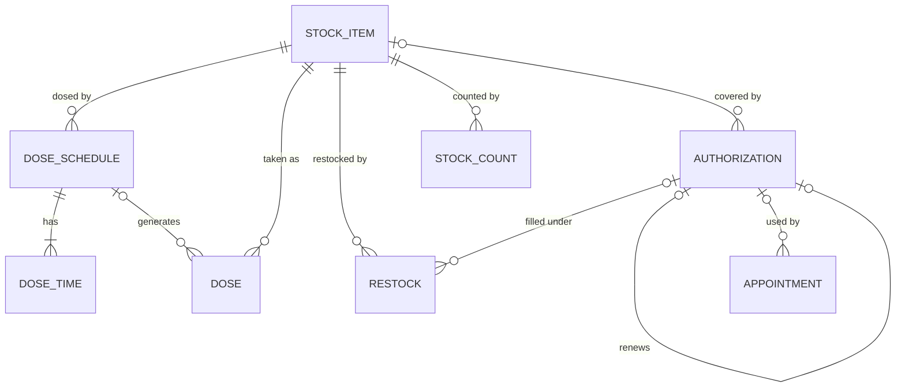

# Data model

The domain schema for the app. Terms follow [GLOSSARY.md](../../GLOSSARY.md). It replaces the PRD's schema, which was a starting point only.

Types are written Postgres-style but stay stack-neutral. Infrastructure tables (push subscriptions, auth, email-sending state) are not part of the domain and come with the stack choice.

## Stock

### `stock_items`
| column | type | notes |
|---|---|---|
| id | uuid | |
| name | text | |
| kind | enum `medication` \| `supply` | |
| strength | text, null | e.g. "50 mg"; medications only |
| unit | text | pill, ml, strip, piece… |
| quantity | numeric | current stock in units; may go **negative** (flagged in the UI) |
| low_stock_threshold | numeric | |
| pack_size | numeric, null | units per pack, for entering restocks in packs |
| archived_at | timestamptz, null | |
| created_at | timestamptz | |

`quantity` is stored and updated in the same transaction as the event that changes it (a taken Dose, a Restock, or a Stock Count). History comes from those events, not from replaying them.

### `restocks`
| column | type | notes |
|---|---|---|
| id | uuid | |
| stock_item_id | uuid → stock_items | |
| quantity | numeric | units added (packs × pack_size, converted at entry) |
| restocked_on | date | |
| authorization_id | uuid → authorizations, null | the Authorization it was filled under |
| note | text, null | |

### `stock_counts`
| column | type | notes |
|---|---|---|
| id | uuid | |
| stock_item_id | uuid → stock_items | |
| counted_quantity | numeric | the new quantity |
| previous_quantity | numeric | the quantity before; the difference is the drift |
| counted_at | timestamptz | |

## Dosing

### `dose_schedules`
A medication's schedule. Editing a schedule **ends the current version and starts a new one**, so past Doses keep pointing at the schedule they were generated from.

| column | type | notes |
|---|---|---|
| id | uuid | |
| stock_item_id | uuid → stock_items | medications only |
| pattern | enum `daily` \| `weekdays` \| `every_n_days` \| `as_needed` | |
| weekdays | smallint[], null | 0–6, for `weekdays` |
| interval_days | int, null | for `every_n_days` (counted from `effective_from`) |
| effective_from | date | defaults to today; never in the past. A future date keeps the previous version in force until then |
| effective_to | date, null | **exclusive**; null = current version |
| created_at | timestamptz | a version saved mid-day generates no Dose due before this moment, so the morning isn't backdated |

If two Dose Times of one version fall on the same instant (a spring-forward time moved onto another time, e.g. 02:30 and 03:30), one Dose is created, with the first time's amount.

### `dose_times`
| column | type | notes |
|---|---|---|
| id | uuid | |
| dose_schedule_id | uuid → dose_schedules | none for `as_needed` |
| time_of_day | time | wall-clock time in the owner's time zone (Asia/Jerusalem, one app-wide setting) |
| amount | numeric | units per dose at this time |

**Daylight-saving days.** A wall-clock time that doesn't exist (spring forward, 02:00 → 03:00) moves forward by the gap: 02:30 becomes 03:30. A time that happens twice (fall back, 02:00 → 01:00) gets **one** Dose, at the later occurrence. This is Postgres's own reading of a local time in `Asia/Jerusalem`, so no special code is needed. The same rule applies to the Daily Alert Time and Appointment Reminders. pgTAP tests pin both days ([testing.md](testing.md)).

### `doses`
| column | type | notes |
|---|---|---|
| id | uuid | |
| stock_item_id | uuid → stock_items | |
| dose_schedule_id | uuid → dose_schedules, null | null for As Needed doses |
| due_at | timestamptz, null | null for As Needed doses |
| amount | numeric | |
| status | enum `pending` \| `taken` \| `skipped` \| `missed` | As Needed doses are created as `taken` |
| taken_at | timestamptz, null | |
| status_changed_at | timestamptz | |

Moving into or out of `taken` (including a late fix from `missed`) changes `stock_items.quantity` by `amount`. A Dose becomes `missed` when its confirmation window passes; the window is set in [alert-rules.md](alert-rules.md): the earlier of 24 hours after `due_at` or the next Dose of the same Stock Item.

## Authorizations

### `authorizations`
| column | type | notes |
|---|---|---|
| id | uuid | |
| type | enum `prescription` \| `form_17` \| `commitment` | |
| reference_number | text | may repeat across rows (one paper prescription, several medications) |
| covers | text | free text, e.g. "6 physio sessions at Clinic B" |
| stock_item_id | uuid → stock_items, null | at most one Stock Item |
| issued_on | date, null | |
| expires_on | date | |
| renews_authorization_id | uuid → authorizations, null, unique | the one this replaces; that one is now *renewed* |
| archived_at | timestamptz, null | |

*Renewed* is derived: another row points at this one through `renews_authorization_id`. Only Authorizations that are neither renewed nor archived raise expiry alerts.

## Appointments

### `appointments`
| column | type | notes |
|---|---|---|
| id | uuid | |
| title | text | real title; app-only |
| starts_at | timestamptz | |
| ends_at | timestamptz | |
| provider | text, null | |
| location | text, null | |
| notes | text, null | before the visit |
| visit_summary | text, null | after the visit |
| authorization_id | uuid → authorizations, null | the Form 17 / Commitment it uses; no session counting |
| buffer_before_minutes | int, default 0 | Travel Buffer |
| buffer_after_minutes | int, default 0 | Travel Buffer |
| send_to_work_calendar | bool, default true | |
| cancelled_at | timestamptz, null | |
| invite_uid | text | stable iCalendar UID for the Work Calendar Invite |
| invite_sequence | int, default 0 | increased on every update or cancellation sent |

Status is derived: *cancelled* if `cancelled_at` is set, otherwise *done* once `ends_at` has passed, otherwise *scheduled*. The Work Calendar Invite always uses the neutral title "Personal appointment" and blocks `starts_at − buffer_before` to `ends_at + buffer_after`.

## History and reports

There is no generic history-log table. Reports read the records themselves (what each report shows is in [reports.md](reports.md)):
- **Dose history** from `doses`
- **Previous renewals** from the `authorizations` renewal chain and from `restocks`
- **Visit summaries** from past `appointments`
