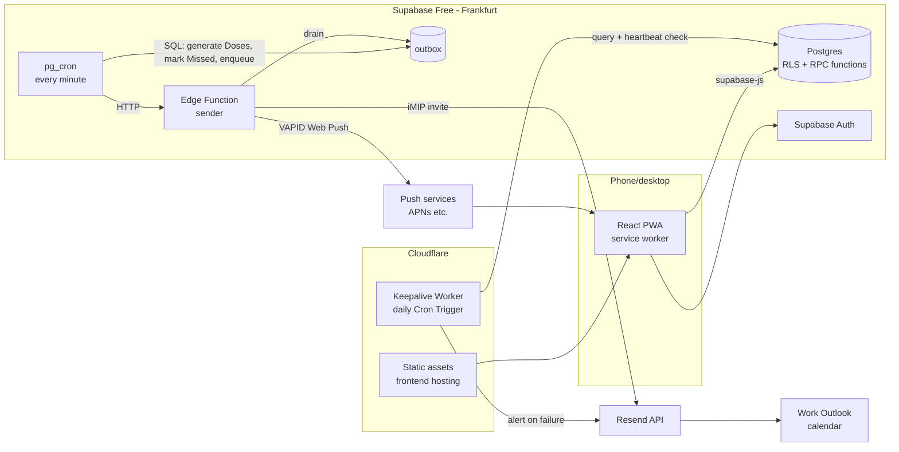

# Stack

The technology choices for the app, decided in [Stack choice](https://github.com/HADKASHI/medical-management-app/issues/6). Domain terms follow [GLOSSARY.md](../../GLOSSARY.md); the domain schema is in [data-model.md](data-model.md). Lock-in decisions are recorded in [ADR 0003](../adr/0003-supabase-free-with-external-keepalive.md) and [ADR 0004](../adr/0004-domain-logic-in-postgres-with-outbox.md).



## Summary

| Area | Choice |
|---|---|
| Language | TypeScript everywhere (frontend, Edge Functions on Deno, Worker) |
| Frontend | React + Vite single-page app, no server rendering |
| Routing | React Router |
| Server state | TanStack Query over `supabase-js`, cache persisted to IndexedDB |
| UI | Tailwind CSS + shadcn/ui (Radix) |
| Dates | UTC `timestamptz` in storage; display in `Asia/Jerusalem` with `date-fns` + `@date-fns/tz` |
| PWA | `vite-plugin-pwa`, `injectManifest` strategy (own service worker) |
| Frontend hosting | Cloudflare (Workers static assets), deployed by Cloudflare's GitHub integration |
| Backend | Supabase Free, Frankfurt (`eu-central-1`): Postgres, Auth, pg_cron, Edge Functions |
| Business rules | Postgres: RLS, RPC functions, pg_cron SQL ([ADR 0004](../adr/0004-domain-logic-in-postgres-with-outbox.md)) |
| Push | Web Push with VAPID via `@negrel/webpush` in an Edge Function; Declarative Web Push payloads |
| Invite email | Resend HTTP API; Mailgun (raw MIME) as fallback |
| Domain | One `.com` at Cloudflare Registrar |
| Auth | Supabase email + password, sign-up disabled, no MFA in v1 |
| Keepalive | Per-minute heartbeat row + daily Cloudflare Worker check ([ADR 0003](../adr/0003-supabase-free-with-external-keepalive.md)) |
| Monitoring | Outbox failure tracking + in-app banner; Supabase logs; no Sentry |
| Repo | One repo, one package; pnpm, Node LTS |
| Tooling | Vitest, ESLint, Prettier |
| Environments | Local Supabase CLI stack (Docker) + one hosted production project |
| CI/CD | GitHub Actions |

## Frontend

- **React + Vite SPA in TypeScript.** Builds to static files; Supabase is the only backend, so there is no server rendering.
- **Data access:** the client calls Supabase directly with `supabase-js`. Row-level security limits every row to the owner's user id. Database types are generated with `supabase gen types typescript` and committed.
- **Caching:** TanStack Query, with the query cache persisted to IndexedDB.
- **Offline:** read-only. The app shell is precached and the last-fetched data stays visible. Every change (Taken, Restock, edits) needs the network; while offline the app shows an "Offline" banner and disables write actions. There is **no offline write queue**: reminders and Missed marking happen on the server, so queued offline writes would conflict with them.
- **Service worker:** written by us, built with `vite-plugin-pwa` in `injectManifest` mode. It holds the Workbox precache plus `push` and `notificationclick` handlers (the fallback for clients without Declarative Web Push). Tapping a reminder opens its confirm screen (e.g. `/reminders/<id>`) with Taken / Snooze, since iOS has no notification action buttons.
- **Install:** the iPhone must add the app to the Home Screen (iOS 16.4+). The push permission prompt is triggered from a user tap.
- **Dates:** every instant is stored as UTC `timestamptz` and shown in Israel time (`Asia/Jerusalem`) using `date-fns` + `@date-fns/tz`, matching the data model's rule that schedules use Israel time.

## Backend (Supabase Free, Frankfurt)

### Where logic lives

See [ADR 0004](../adr/0004-domain-logic-in-postgres-with-outbox.md).

- **RPC functions** (Postgres functions, `security invoker`, called with `supabase.rpc`) for every operation that touches more than one row, so it runs in one transaction. Examples: taking a Dose (update the Dose and the Stock Item quantity), recording a Stock Count, editing or deleting an Appointment (bump `ical_sequence` and enqueue the invite).
- **Per-minute pg_cron job** (SQL) that:
  1. generates pending Doses from active Dose Schedules (times in `Asia/Jerusalem`),
  2. marks overdue Doses as Missed,
  3. computes due reminders and enqueues them in the **outbox**,
  4. writes the **heartbeat** row,
  5. calls the sender Edge Function over HTTP (`pg_net`) when the outbox has pending rows.
- **Sender Edge Function** does outbound I/O only: it claims pending outbox rows, sends the Web Push or invite email, and records the result. No domain rules live there.

### Infrastructure tables

Not part of the domain model; owned by the stack.

| table | purpose |
|---|---|
| `push_subscriptions` | one row per installed device/browser: endpoint, keys, user agent label, created/last-success timestamps |
| `outbox` | pending outbound messages: kind (`push` / `invite`), payload, status, attempts, last error, timestamps |
| `heartbeat` | single row updated by the per-minute job; read by the keepalive Worker |

### Push

- Standard Web Push with VAPID, sent by the sender Edge Function using **`@negrel/webpush`** (Deno-native, Web Crypto). Fallback: `npm:web-push`. Confirm with a small spike at the start of the build.
- **Declarative Web Push** payload format (iOS 18.4+ shows it without running the service worker); the service worker handles the same payload on older clients and desktop.
- Each reminder goes to **every** stored subscription. Headers: `Urgency: high`, a short `TTL`. A `404` or `410` response deletes the subscription.
- Settings has a **"Send test notification"** button.
- Which reminders exist, and when they repeat, is decided in [Alert rules](https://github.com/HADKASHI/medical-management-app/issues/7).

### Invite email

- iMIP invites (per [ADR 0001](../adr/0001-work-calendar-via-email-invites.md)) sent by the sender Edge Function through the **Resend HTTP API** (Edge Functions block outbound SMTP).
- **Mailgun** (`/v3/{domain}/messages.mime`, raw MIME) is the fallback if Exchange won't treat Resend's message as an invite; the choice is made during the build's invite check.
- Sender address on a `cal.` subdomain of our own domain, with SPF, DKIM and DMARC (`p=none`).

### Secrets

| secret | where |
|---|---|
| VAPID private key, Resend API key | Supabase Edge Function secrets |
| VAPID public key, Supabase URL, anon key | frontend build-time env vars (public by design) |
| Supabase access token, Cloudflare API token | GitHub Actions secrets |
| Keepalive Worker's Supabase key and Resend key | Cloudflare Worker secrets |

Supabase Vault is not used: with Graph ruled out there are no runtime-issued tokens to store.

### Auth

- **Supabase Auth, email + password.** The owner's account is created once, then **public sign-up is disabled** in the project settings.
- Every table has RLS policies allowing only the owner's `auth.uid()`.
- Long-lived sessions (refresh token in the PWA's storage). Password reset by email is the recovery path. The password lives in iCloud Keychain.
- No magic links: on iPhone the link opens in Safari, which does not share storage with the Home Screen app.
- No TOTP / MFA in v1; Supabase supports it if wanted later.

## Keepalive and monitoring

Free projects pause after 7 days of low activity, and a paused project silently stops pg_cron. See [ADR 0003](../adr/0003-supabase-free-with-external-keepalive.md).

1. The per-minute pg_cron job writes the `heartbeat` row.
2. A **Cloudflare Worker on a daily Cron Trigger** (`workers/keepalive`) calls a small Supabase endpoint that runs a real query and returns the heartbeat's age. On an error or a heartbeat older than a few minutes, it emails the owner through Resend.
3. Supabase's own pause-warning email is the last-resort alarm.

A scheduled GitHub Action is **not** used: GitHub disables scheduled workflows in repos with no activity for 60 days.

**Monitoring:** no Sentry. Outbox rows track failures (attempts, last error); the app shows a **"Delivery problems"** banner when any push or invite has permanently failed. Everything else is read from the Supabase function logs.

## Repo layout

One repo, one package, no monorepo tooling.

```
/
├── src/                      # React app
├── public/
├── supabase/
│   ├── migrations/           # SQL schema, RLS, RPC functions, pg_cron jobs
│   ├── functions/
│   │   ├── _shared/          # shared Deno code
│   │   └── send-outbox/      # sender Edge Function
│   ├── tests/                # SQL tests
│   └── config.toml
├── workers/
│   └── keepalive/            # Cloudflare Worker + wrangler.toml
├── docs/
├── package.json              # pnpm
└── vite.config.ts
```

Tooling: **pnpm**, current **Node LTS**, **Vitest**, **ESLint + Prettier**. Test layers, folders and the controllable clock are in [testing.md](testing.md).

## Environments

- **Local:** the Supabase CLI local stack (Docker) for development and tests; `supabase db reset` applies migrations and seed data (made-up examples only).
- **Production:** one hosted Supabase project in Frankfurt, one Cloudflare deployment.
- **No staging project:** it would also pause and need its own keepalive.

## Deployment & CI

GitHub Actions:

- **On pull request:** typecheck, lint, Vitest, and SQL tests against the local Supabase stack.
- **On push to `main`:** `supabase db push` (migrations), `supabase functions deploy`, `wrangler deploy` for the keepalive Worker.
- **Frontend:** built and deployed by Cloudflare's own GitHub integration on push to `main`, with preview deployments for PRs.

## Owner checklist (purchases and sign-ups)

To do by the owner before or at the start of the build. Nothing here has been bought or created yet.

1. **Domain:** create a Cloudflare account and buy one `.com` at Cloudflare Registrar (about US$10.50/year).
2. **Supabase:** create a free account and a project in **Frankfurt (`eu-central-1`)**. Create the owner's user, then turn off public sign-ups.
3. **Resend:** create a free account, add the `cal.` subdomain, and add its SPF and DKIM DNS records in Cloudflare. Add a DMARC `p=none` record.
4. **Mailgun:** only if the build's invite check needs the fallback.
5. **Cloudflare:** connect the GitHub repo for frontend deploys and create an API token for `wrangler`.
6. **GitHub:** add the Supabase access token and Cloudflare API token as Actions secrets.
7. **VAPID keys:** generate a key pair; put the private key in Supabase function secrets and the public key in the frontend env.
8. **Work Outlook:** keep the Copilot calendar instruction scoped to the app's sender address (ADR 0001).
